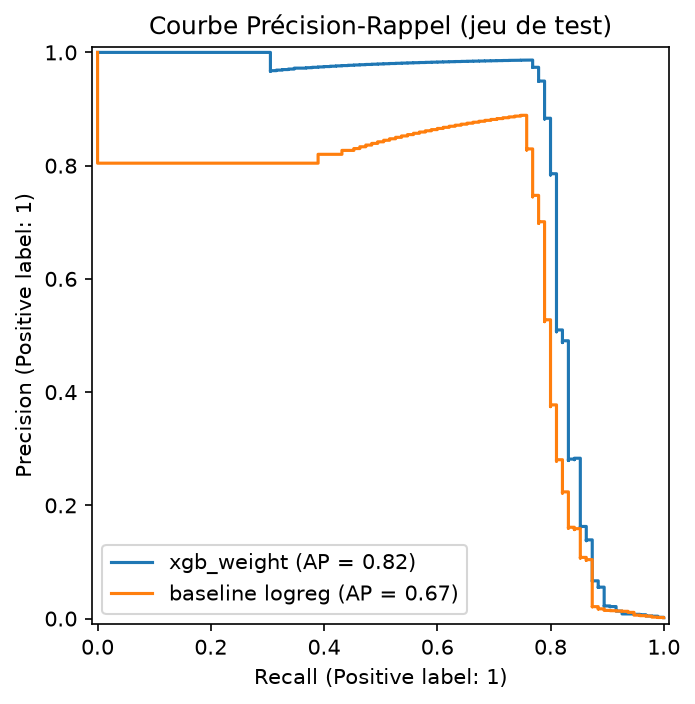
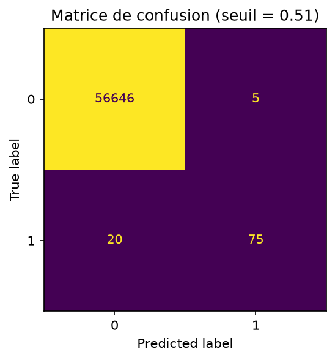
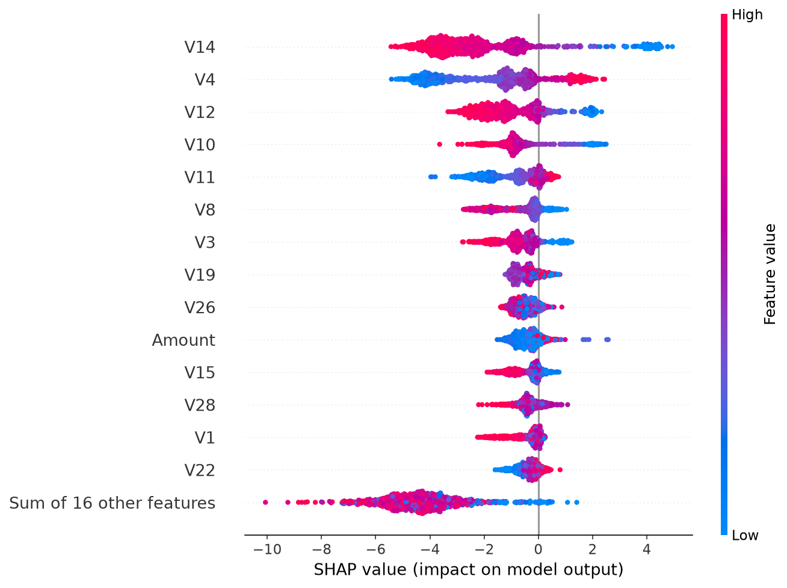
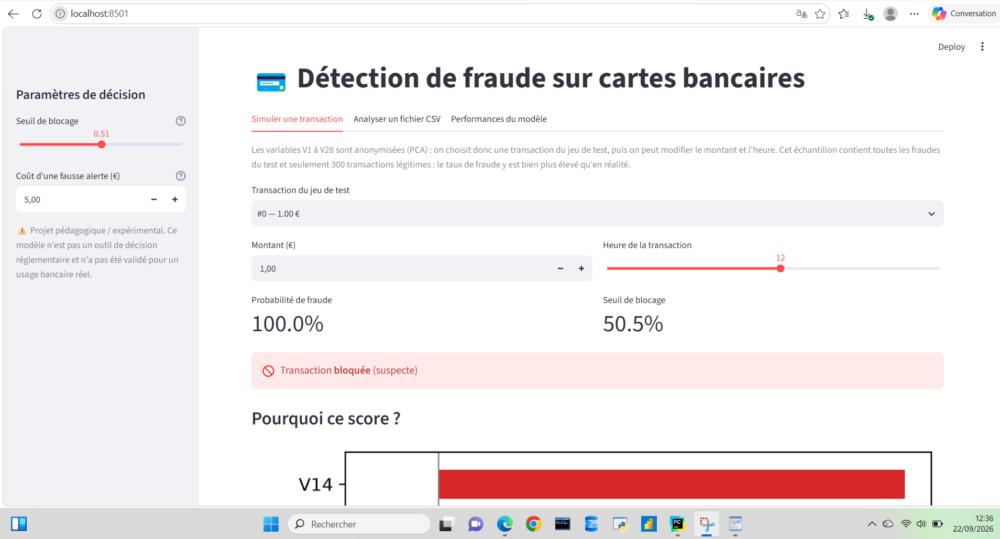
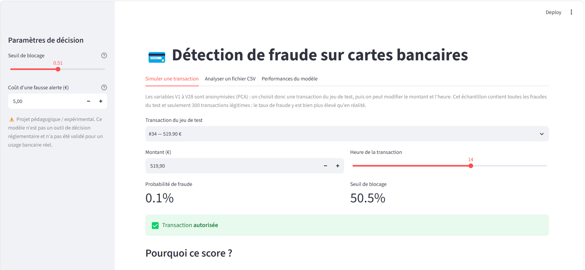
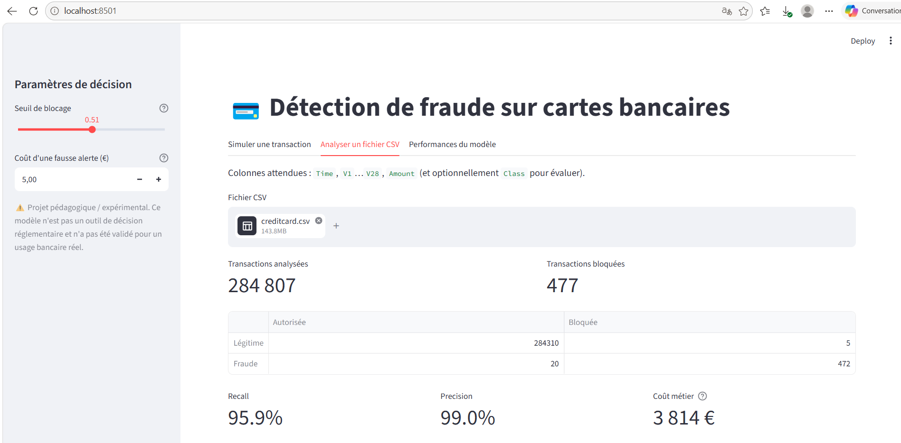
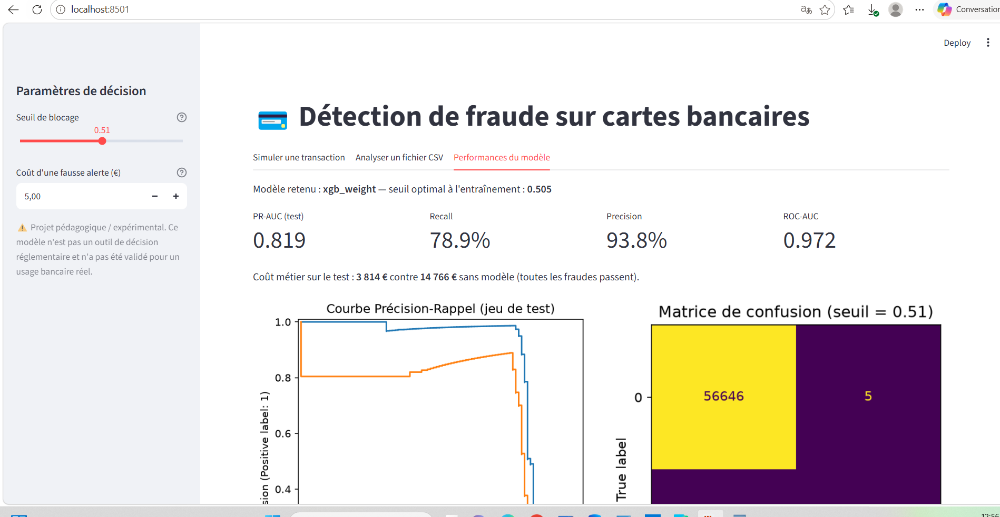

# 💳 Détection de fraude sur cartes bancaires

> ⚠️ **Projet pédagogique / expérimental.** Ce modèle n'est pas un outil de décision réglementaire et n'a pas été validé pour un usage bancaire réel.

## 1. Problème métier
Une banque doit identifier les transactions suspectes **avant** leur validation finale. Deux erreurs coûtent de l'argent :
- une **fraude non détectée** coûte le montant de la transaction ;
- une **fausse alerte** coûte une revue manuelle et de la friction client (hypothèse : 5 € par alerte, paramétrable).

Le projet vise donc à **minimiser un coût métier**, pas à maximiser une accuracy.

## 2. Données
- **Credit Card Fraud Detection** (Kaggle, ULB) : transactions de porteurs de cartes européens sur 2 jours.
- Variables : `Time`, `Amount`, `V1`–`V28` (composantes PCA anonymisées), `Class` (1 = fraude).
- Très fort déséquilibre : ≈ 0,17 % de fraudes.
- Voir `data/README.md` pour le téléchargement.

## 3. Méthodologie (protégée contre le Data Leakage)

1. **EDA** (`notebooks/EDA.ipynb`) : qualité, doublons, déséquilibre, montant/heure, variables discriminantes.
2. **Doublons supprimés avant le split**, puis **split train/test stratifié** isolé dès le départ.
3. **Un seul pipeline `imblearn`** (`features.py` + `train.py`) : heure de la journée → `RobustScaler` sur `Amount` → (SMOTE) → XGBoost.
   SMOTE est *dans* le pipeline : il n'est appliqué qu'aux données d'entraînement de chaque fold de validation croisée.
4. **Comparaison de 3 stratégies** en validation croisée stratifiée (5 folds), sur le train uniquement, avec la **PR-AUC** :
   régression logistique (baseline), XGBoost pondéré (`scale_pos_weight`), XGBoost + SMOTE.
5. **Choix du seuil de décision** sur les probabilités *out-of-fold* du train (jamais sur le test), en minimisant le coût métier.
6. **Évaluation finale unique** sur le test : PR-AUC, Recall, Precision, matrice de confusion, coût vs « sans modèle ».
7. **Explicabilité** : SHAP (globale dans `reports/`, locale dans l'application).






## 4. Résultats

| Modèle | PR-AUC (CV, out-of-fold) |
|---|---|
| Régression logistique (baseline) | 0,742 |
| XGBoost + pondération des classes | **0,850** |
| XGBoost + SMOTE | 0,842 |

Sur le jeu de test (56 746 transactions, 95 fraudes), au seuil retenu (0,51, centre du plateau de coût
sur la validation croisée) : PR-AUC = 0,819, Recall = 78,9 %, Precision = 93,75 %,
coût métier = 3 814 € contre 14 766 € sans modèle (hypothèse : 5 € par fausse alerte).

75 fraudes sur 95 sont détectées, pour seulement 5 fausses alertes sur 56 651 transactions légitimes.
Les 20 fraudes manquées concentrent l'essentiel du coût restant.

- Avec seulement 95 fraudes dans le test, le Recall (78,9 %) varie sensiblement selon le split :
  une fraude de plus ou de moins déplace le chiffre d'environ 1 point.
- Le seuil de décision est choisi sur le centre d'un plateau de coût quasi plat entre 0,1 et 0,78,
  plutôt qu'un minimum ponctuel plus instable — mais le coût final ne dépend presque pas de ce choix
  précis dans cette zone.



### Exemple de faux négatif

Le modèle n'est pas infaillible : sur la transaction ci-dessous (519,90 €), il estime la probabilité
de fraude à seulement 0,1 % et l'autorise, alors qu'il s'agit d'une fraude réelle. C'est l'un des
20 faux négatifs du jeu de test.





*(les métriques affichées ici portent sur le fichier complet, entraînement inclus, donc elles sont
optimistes — voir la section Résultats ci-dessus pour la mesure fiable, sur le jeu de test seul)*



## 5. Limites
- Variables V1–V28 anonymisées : pas d'interprétation métier directe des facteurs.
- Données de 2013, 2 jours seulement : pas de test de robustesse à la dérive temporelle, or les schémas de fraude évoluent vite.
- Le coût d'une fausse alerte (5 €) est une **hypothèse** ; le seuil optimal en dépend.
- Peu de fraudes (quelques centaines) : les métriques ont une forte variance.
- Pas de validation réglementaire, pas de monitoring en production.

## 6. Lancer le projet
```bash
python -m venv .venv && source .venv/bin/activate      # Windows : .venv\Scripts\activate
pip install -r requirements.txt
# placer creditcard.csv dans data/ (voir data/README.md)
python train.py            # entraîne, évalue, sauvegarde modele_pipeline.pkl + reports/
streamlit run app.py       # ouvre l'application
```

## 7. Structure
```
├── data/                 # données (creditcard.csv à télécharger) + sample_test.csv pour l'app
├── notebooks/EDA.ipynb   # exploration
├── reports/              # métriques et figures générées par train.py
├── features.py           # feature engineering partagé (train + app)
├── train.py              # pipeline, validation, seuil, évaluation, sauvegarde
├── app.py                # application Streamlit
├── modele_pipeline.pkl   # pipeline + seuil sauvegardés (joblib)
└── requirements.txt
```

